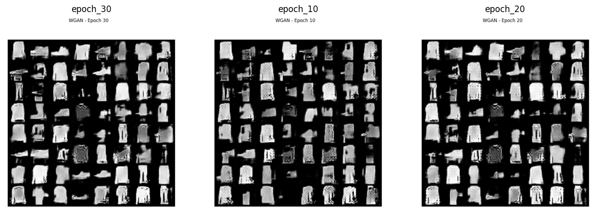
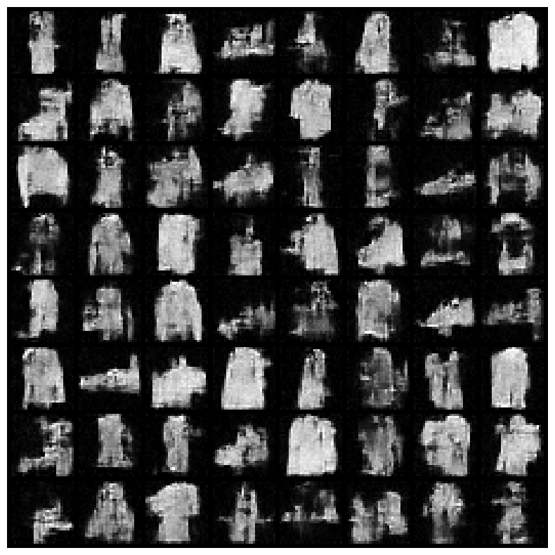
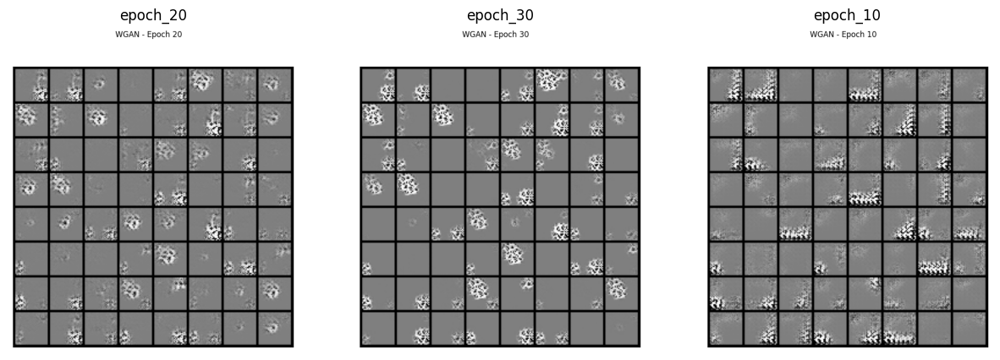
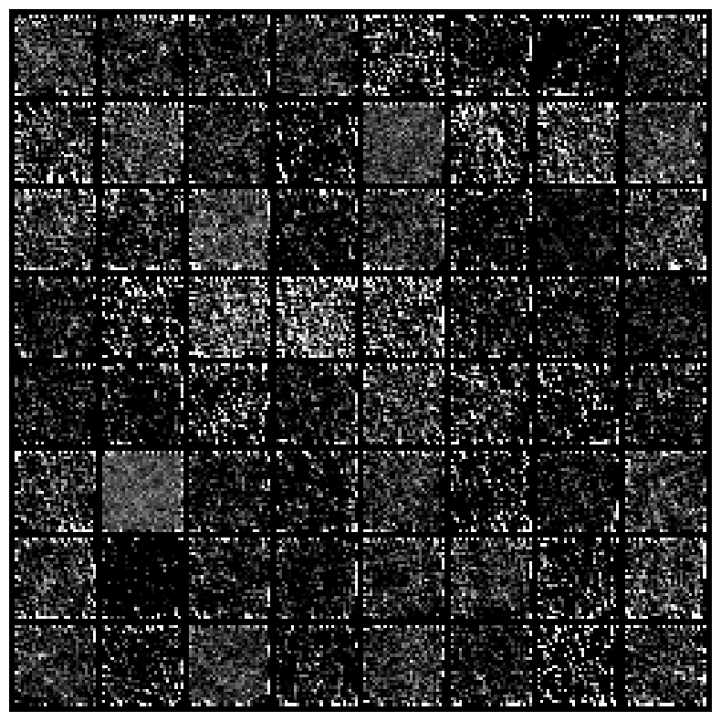

# Deep Learning génératif — Comparaison des WGAN et SGM

**Projet académique · Génération d’images · PyTorch · Google Colab (GPU)**

**Auteurs : Fatoumata NDOUR et Valentin ABONGO**

## Présentation

Ce projet compare deux familles de modèles génératifs de Deep Learning pour **apprendre une distribution d’images et produire de nouveaux échantillons** :

- **WGAN (Wasserstein Generative Adversarial Network)** : apprentissage adversarial entre un générateur et un critique, fondé sur la distance de Wasserstein.
- **SGM (Score-Based Generative Model)** : apprentissage du score d’une distribution, puis génération par débruitage progressif à l’aide d’un processus de diffusion.

La démarche consiste à confronter les méthodes à **deux distributions différentes** et à examiner la qualité visuelle, la diversité des résultats et les difficultés d’entraînement. Les conclusions rapportées sont **expérimentales et principalement qualitatives**.

## Jeux de données

| Jeu de données | Description | Intérêt de la comparaison |
| --- | --- | --- |
| **Fashion-MNIST** | Images en niveaux de gris de vêtements et d’accessoires, **28 × 28 pixels** ; apprentissage sans utiliser les étiquettes | Étudier une distribution multimodale, la variété des objets et la restitution des détails |
| **Cercles synthétiques** | **10 000 images** de cercles de positions et tailles variables, **28 × 28 pixels** ; **8 000** pour l’entraînement et **2 000** pour la validation | Tester l’apprentissage d’une structure géométrique simple, mais fortement contrainte |

## Méthodes et implémentation

### WGAN

L’architecture convolutionnelle comprend un **générateur** (convolutions transposées, ReLU, normalisation par lots, sortie *tanh*) et un **critique** (convolutions, LeakyReLU). Le générateur reçoit un vecteur gaussien de dimension 100.

**Configuration décrite dans le rapport :** RMSProp ; taux d’apprentissage `5e-5` ; batch de 64 ; **5 mises à jour du critique** par mise à jour du générateur ; *weight clipping* de `0.01`. Plusieurs configurations ont été essayées ; **30 époques** ont été retenues comme compromis entre stabilité et qualité visuelle dans l’expérimentation rapportée.

### SGM

L’implémentation utilise **TorchDiff**, un réseau de type **U-Net**, un bruitage **Variance Preserving (VP-SDE)** et l’optimiseur **AdamW** avec un taux d’apprentissage de `1e-4`. La génération s’effectue par simulation du processus stochastique inverse avec la méthode d’**Euler–Maruyama**. Le rapport mentionne une discrétisation pouvant atteindre **1 000 pas**, ainsi qu’un *early stopping* lors de certains entraînements.

## Résultats expérimentaux

### Fashion-MNIST

Les deux méthodes apprennent **les formes générales** des objets, mais reproduisent imparfaitement les **détails fins**.

- **WGAN :** formes progressivement reconnaissables ; certaines catégories paraissent surreprésentées, ce qui suggère un *mode collapse* partiel.
- **SGM :** diversité visuelle apparemment supérieure dans les échantillons observés ; les détails restent toutefois approximatifs.

**Exemples issus des notebooks d’origine :**

| WGAN — Fashion-MNIST | SGM — Fashion-MNIST |
| --- | --- |
|  |  |

### Cercles synthétiques

**Aucun des deux modèles ne reconstruit convenablement les cercles** dans les configurations testées. Les générations WGAN restent bruitées ; les résultats SGM ne restituent pas non plus la structure circulaire attendue.

| WGAN — Cercles | SGM — Cercles |
| --- | --- |
|  |  |

### Synthèse

| Critère | WGAN | SGM |
| --- | --- | --- |
| Structure globale sur Fashion-MNIST | Apprise | Apprise |
| Détails fins sur Fashion-MNIST | Limités | Limités |
| Diversité des images | Certaines catégories semblent favorisées | Diversité visuelle apparemment supérieure |
| Reconstruction des cercles | Insuffisante | Insuffisante |
| Difficultés mises en évidence | Détails et couverture des modes | Coût de calcul et restitution des structures contraintes |

> **Portée des résultats :** les observations ne démontrent pas qu’un modèle est généralement supérieur à l’autre. La comparaison dépend des architectures, des hyperparamètres, des données et du protocole étudiés. Aucune mesure quantitative standardisée de qualité ou diversité (par exemple FID) n’est rapportée dans ce travail.

## Notebooks et exécution

**Les notebooks ont été entraînés sur Google Colab avec accélération GPU**, pour prendre en charge le coût de calcul des modèles, notamment des SGM. Ils ont été conçus pour cet environnement : certains chemins, dépendances ou paramètres peuvent nécessiter une adaptation pour une exécution locale. Les résultats illustrés ci-dessus sont extraits des **sorties enregistrées dans les notebooks**, et non d’une nouvelle exécution.

| Notebook | Expérimentation |
| --- | --- |
| [`WGAN_fmnist.ipynb`](notebooks/WGAN_fmnist.ipynb) | WGAN sur Fashion-MNIST |
| [`WGAN_circles.ipynb`](notebooks/WGAN_circles.ipynb) | WGAN sur les cercles synthétiques |
| [`SGM_fmnist.ipynb`](notebooks/SGM_fmnist.ipynb) | SGM sur Fashion-MNIST |
| [`SGM_circles.ipynb`](notebooks/SGM_circles.ipynb) | SGM sur les cercles synthétiques |

**Outils utilisés :** Python, PyTorch, TorchDiff, réseaux convolutionnels, U-Net, Jupyter Notebook, Google Colab et GPU.

## Organisation du dépôt

```text
DeepLearning/
├── README.md
├── Consignes_evaluation.pdf
├── Rapport_de_deep_learning.pdf
├── images/
│   ├── wgan_fashion_mnist.png
│   ├── sgm_fashion_mnist.png
│   ├── wgan_cercles.png
│   └── sgm_cercles.png
└── notebooks/
    ├── WGAN_fmnist.ipynb
    ├── WGAN_circles.ipynb
    ├── SGM_fmnist.ipynb
    └── SGM_circles.ipynb
```

## Documentation

- 📄 [**Rapport complet**](Rapport_de_deep_learning.pdf) : théorie, choix méthodologiques, protocoles, illustrations et discussion des résultats.
- 📋 [**Consignes d’évaluation**](Consignes_evaluation.pdf) : énoncé du projet académique.

Les exemples visuels présentés dans ce README proviennent des expériences conservées dans les notebooks du dépôt.

---

*Projet réalisé en collaboration par Fatoumata NDOUR et Valentin ABONGO.*
